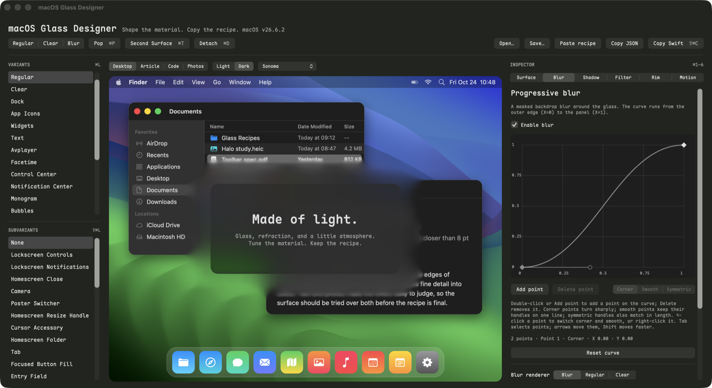

`macOS Glass Designer` lets you tune native macOS glass and hand an agent the exact parameters. Browse materials with the keyboard, adjust the surface and its surroundings, and copy a standalone Swift parameter specification for use from Swift, Rust, Qt, or another macOS bridge.

# What It Does

- **Browse instantly.** Arrow through 21 variants and 33 subvariants without pressing Enter. Type a name to jump through a list.
- **Tune the whole effect.** Adjust tint, fill, dimensions, merging, appearance states, progressive blur or masked-glass halos, a Bézier strength curve with corner, smooth, and symmetric points, system and custom shadows, 19 background filter inputs, and 5 rim inputs.
- **See the context.** Place the glass over a desktop with app windows, a web article, a code editor, or a photo library, each in a light or dark theme on any installed wallpaper, or detach a transparent preview over your real windows.
- **Preview motion.** Try pop, Emerge, Unfold, Slide, and Expand effects, with Reduce Motion respected.
- **Keep exact recipes.** Copy Swift with units and API mapping, copy JSON, or save and reopen JSON recipes. Fractional values survive export.

# How It Works

1. Start from the Regular, Clear, or Blur preset.
2. Focus Variants with **⌘L** or Subvariants with **⇧⌘L**. Move with **↑/↓** to apply each selection immediately.
3. Select an inspector with **⌘1–6** and adjust sliders or enter numeric values. Each value sits at the right end of its label, with a full-width slider and a gray description beneath; click a value to type an exact one. The interface uses bundled Maple Mono.
4. Drag the glass to move it over any part of the scene. Use **Detach / ⌘D** to move the preview over your desktop. Use **⌘P** for pop and **⌘T** for the second surface.
5. Click **Copy Swift / ⇧⌘C** and paste into an agent conversation. Use Save to retain an editable recipe.

# How it Really Works

1. The preview renders actual macOS glass. Materials can react to appearance, background, and system accessibility settings; different material names can produce similar results in some contexts. The scene behind the embedded glass has its own Light/Dark theme, separate from the glass Appearance, so dark glass can be judged over light apps. Its wallpapers are read from this Mac (the current desktop picture first); dynamic wallpapers such as Sonoma switch variants with the theme, and the flat Solid Colors are not offered.
2. Filter and rim controls show values read from the current material. Adjusting a control creates an explicit override. Unchecking it restores the material's native value.
3. Swift output is a parameter specification, with implementation notes for an agent; it is not a complete renderer. Missing override keys mean “use AppKit's value.” Comments list AppKit's native filter values, read before any override is applied, so an overridden input still shows what it replaces. Colors are sRGB HSBA, as `NSColor(hue:saturation:brightness:alpha:)` builds them. Numeric displays round to two decimal places; recipes and exports retain full precision.
4. Copy Swift also places a JSON recipe on the clipboard. **Paste recipe / ⇧⌘V** restores it within the designer. Plain JSON works too. A recipe that cannot load leaves the current one untouched and names the unsupported schema version or the faulty field, such as `parameters.cornerRadius`. Files and clipboard contents stay local; the app makes no network requests and does not save sessions automatically.
5. Advanced material states, refraction, rim, and progressive blur use undocumented macOS interfaces. They are verified on macOS 26.6.2; their availability and appearance can change across OS versions. Unavailable inputs are disabled or reported below the preview. Larger surfaces and halos may extend beyond the embedded stage; detach to see the full extent.

# Prerequisites

- macOS 26 or later for [native Liquid Glass](https://developer.apple.com/documentation/appkit/nsglasseffectview). Private controls are verified on macOS 26.6.2, Apple Silicon.

# Installation

Open `dist/macOS Glass Designer.app` from this workspace. To keep it with your applications, drag that bundle to `~/Applications`. The local bundle is ad-hoc signed. Developer setup is in [CONTRIBUTING.md](CONTRIBUTING.md).

# Quick Start

Open the app, press **⌘L**, and hold **↓** to compare materials. Press **⇧⌘L** to explore subvariants. Press **⌘4** to tune blur and refraction, then **⇧⌘C** to copy Swift parameters.

# Configuration

| Inspector | Controls |
| :--- | :--- |
| Surface · ⌘1 | Glass on/off, titled desktop preview, geometry, merge distance, panel gap, tint/fill HSBA, backing dim, appearance, lensing, subdued/scrim/adaptive/interaction states |
| Blur · ⌘2 | Editable curve with arbitrary corner, smooth, or symmetric points and Bézier handles, enable, progressive blur / regular / clear renderer, blur under panels, margin, radius, dimming |
| Shadow · ⌘3 | System window shadow, custom opacity/radius/offset, reduced glass shadow radius |
| Filter · ⌘4 | Refraction, backdrop blur, color bleed, inner shadow, face opacity/color matrix, SDR shading |
| Rim · ⌘5 | Key/fill strength and spread, curvature |
| Motion · ⌘6 | Pop duration/shrink/opacity, secondary effect/easing/duration |

Distances use points, durations seconds, and sRGB HSBA colors and opacity values use 0–1. Native window shadows are visible in the detached preview. The custom shadow and system shadow can be enabled independently.

In Blur, drag a point or its handles to shape the curve. X runs from the outer halo edge to the panel; Y controls blur and dimming strength.

| Action | Controls |
| :--- | :--- |
| Add a point on the curve | **Add point**, double-click, or right-click the curve and choose **Add Point Here** |
| Remove the selected point | **Delete point**, **Delete**, or the point's right-click menu; at least two points remain |
| Set the point type | The **Corner / Smooth / Symmetric** control, the point's right-click menu, or **⌥-click** to switch corner and smooth |
| Select and move points | **Tab** and **⇧Tab** select points; **arrow keys** move the selection, with **Shift** for larger steps |

Corner points turn sharply, with handles that move independently. Smooth points keep both handles on one line, so dragging one rotates the other. Symmetric points also keep both handles the same length. Endpoints have a single handle and are always corners. A handle that would leave its segment or the 0–1 range shortens along its line instead. Adding a point keeps the curve's shape, so a symmetric neighbour becomes smooth. Save and clipboard recipes use schema version 3; earlier versions are unsupported.

# Related Tools

GitHub research identified [LiquidGlassEffects / GlassLab](https://github.com/HoYeonPark1221/LiquidGlassEffects) as the closest material browser and Swift exporter. [qt-liquid-glass](https://github.com/fsalinas26/qt-liquid-glass) explores native glass from Qt, and [VisualEffectDebugger](https://github.com/insidegui/VisualEffectDebugger) explores the older visual effect materials. Source evidence is recorded in the [glass reference](docs/internal/references/glass.md).

# License

[MIT](LICENSE); bundled Maple Mono fonts use the [SIL Open Font License](Sources/GlassDesign/Resources/Fonts/LICENSE.txt).
